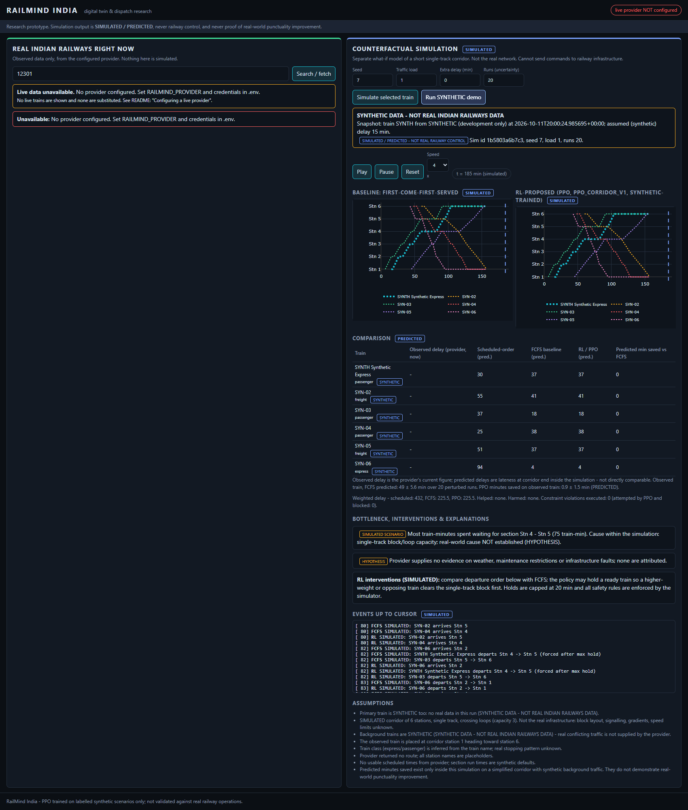

# RailMind India

Research prototype: a Flask dashboard that (left) shows **observed** Indian Railways train
status from an authorised live-data provider and (right) runs a **simulated, counterfactual**
single-track corridor comparing scheduled-order and first-come-first-served dispatching with a
PPO policy trained on **synthetic** scenarios.

> It is not railway control software. It never sends commands to railway infrastructure, and
> simulated improvements do **not** prove real-world punctuality gains.



**Screenshot honesty:** the image above is a genuine capture of the running app, but **live data
was not available** (no authorised provider credential exists in this environment). The left
panel shows the honest "unavailable" state; the right panel shows the clearly labelled
`SYNTHETIC DATA - NOT REAL INDIAN RAILWAYS DATA` demo. No real-time capture was made.

## Status of live data

| Item | State |
|---|---|
| Official source | NTES (indianrail.gov.in) is the public portal; **no public API or data terms were found**, so it is not scraped. |
| Adapter implemented | `rapidapi_irctc` (third-party RapidAPI IRCTC-style API). **Written from public descriptions, never run against a live response** - endpoint path and field names are unverified. |
| Credential | None present. Live status is **not verified**. |
| What you must supply | An authorised API key (and its documented host/path) for a provider whose terms permit this use; see below. |

Without credentials the API returns HTTP 503 `not_configured`, and the UI says so. No
live-looking data is ever substituted.

## Architecture

```
app.py                    Flask app factory + REST API
railmind/config.py        env / .env config (no secrets in code)
railmind/providers/       provider adapters, rate limiter, normalised TrainStatus
railmind/services.py      cache + stale detection, simulation orchestration, job runner
railmind/sim/corridor.py  corridor simulator, hard safety rules, FCFS & scheduled-order baselines
railmind/sim/snapshot.py  builds a labelled scenario from a provider snapshot
railmind/rl/              Gymnasium env, PPO training, held-out evaluation
templates/ static/        dashboard (HTML/CSS/JS, Plotly time-distance diagrams)
docs/SOURCES.md           sources consulted and what each supports
```

### Digital-twin scope
A **6-station single-track corridor** with crossing loops (capacity 3), block occupancy (1 train
per section), 2-minute headway, and a 20-minute cap on holding a ready, safe train (applies to
every policy). Everything else about the real network (signalling, gradients, speed limits,
platforms, rolling-stock) is **not modelled**. The observed train gets its real reported delay,
and its route/schedule when the provider supplies them; background trains are synthetic and
labelled. Assumptions are listed in the dashboard for every run.

### Safety vs. reward
Safety checks live in `Corridor.check_release`, independent of reward. Unsafe requests are
no-ops, counted, and slightly penalised. There is no cancel action; unfinished trains are
charged lateness at the horizon; holds are capped; reward includes a max-delay (fairness) term.

## Install & run

```bash
python -m venv .venv && .venv\Scripts\activate    # Windows; use source .venv/bin/activate elsewhere
pip install -r requirements.txt
copy .env.example .env                             # then edit .env
python app.py                                      # http://127.0.0.1:5000  (RAILMIND_PORT to change)
```

### Configuring a live provider
1. Obtain an authorised key from a provider whose terms allow your use; check its docs for the
   live-status endpoint and response format.
2. In `.env` set `RAILMIND_PROVIDER=rapidapi_irctc`, `RAILMIND_PROVIDER_API_KEY=...`, and the
   provider's `RAILMIND_PROVIDER_HOST` / `RAILMIND_PROVIDER_STATUS_PATH`.
3. Set budgets to match your plan: `RAILMIND_MAX_CALLS_PER_MINUTE`, `RAILMIND_MAX_CALLS_PER_DAY`,
   `RAILMIND_MIN_REFRESH_SECONDS` (responses are cached for that long).
4. Query one train, compare the raw JSON (`status.raw`) with the provider's docs, and adjust
   `RapidApiIrctcProvider.parse` if keys differ. Fields not found are listed as `missing_fields`.

`.env` is git-ignored. Never commit keys.

### Using the app
- **Search:** enter a 5-digit train number, press *Search / fetch* (one provider call, then cached).
- **Simulate:** *Simulate this train* builds a corridor scenario from that snapshot; *Run SYNTHETIC
  demo* needs no provider. Use Play / Pause / Reset and the speed selector; seed, load and extra
  delay are scenario settings. `Runs` perturbs section run times to give mean +/- std.
- **Compare:** observed provider delay is shown separately from the predicted delays under
  scheduled-order, FCFS and PPO, with helped/harmed trains and violations.

### API
`GET /api/health` - `GET /api/trains/search?q=` - `GET /api/trains/<no>/status` -
`POST /api/simulations` (`{train_no}` or `{mode:"synthetic"}`, `seed`, `load`, `extra_delay`,
`uncertainty_runs`) - `GET /api/simulations/<id>` - `POST|GET /api/training` -
`POST|GET /api/evaluation`.

## Training and evaluation

```bash
python -m railmind.rl.train --timesteps 400000     # writes models/ppo_corridor_v1.zip + .json
python -m railmind.rl.evaluate --scenarios 100     # writes models/ppo_corridor_v1_eval.json
```

Training: synthetic scenarios, seeds 0-99 999; behaviour-cloning warm start from the FCFS rule
(300 episodes), then PPO (SB3 2.9.0, lr 5e-5, n_steps 4096, gamma 1.0, MLP 128x128, 400 000
steps, seed 0). The final checkpoint is chosen on validation seeds 50 000+; evaluation uses
disjoint held-out seeds 100 000-100 099. Same scenario, same realised run times for every policy.

### Measured results (this repo's committed run, 100 held-out synthetic scenarios, 6 trains each)

| Policy | Weighted delay (mean +/- std) | Max train delay (mean, min) | Completed | Deadlocks | Forced releases / run |
|---|---|---|---|---|---|
| Scheduled-order | 369.21 +/- 123.31 | 63.75 | 100 % | 0 | 4.35 |
| FCFS | 287.64 +/- 80.01 | 56.35 | 100 % | 0 | 1.88 |
| PPO (v1) | 287.47 +/- 82.79 | 55.95 | 100 % | 0 | 2.16 |

Against FCFS, PPO helped (>1 min) 77 train-instances and harmed 86. PPO attempted 16 unsafe
requests in total; the simulator blocked all of them (executed violations: 0).
**Conclusion: PPO is statistically indistinguishable from FCFS here.** The earlier from-scratch
PPO attempt was worse than FCFS (462.6 weighted delay) and was discarded in favour of the
warm-started run. No claim of RL improvement is made. Numbers are synthetic-only and **not
validated against real railway operations**.

## Data provenance

| Data | Origin | Label |
|---|---|---|
| Left-panel train status | Configured provider response (none available here) | OBSERVED |
| Age / stale flag | Computed locally | calculated |
| Corridor, background trains, PPO training/eval scenarios | `make_scenario` RNG | SYNTHETIC DATA - NOT REAL INDIAN RAILWAYS DATA |
| Right-panel results | Simulator / PPO | SIMULATED / PREDICTED |

Root causes: simulated queueing is reported as `SIMULATED SCENARIO`; weather, maintenance and
infrastructure faults are `HYPOTHESIS` only (no evidence feed). Sources: [docs/SOURCES.md](docs/SOURCES.md).

## Limitations
- Live provider unverified; adapter parser may need adjustment against real responses.
- Corridor is abstract; direction, loop capacity and run times are assumptions.
- Observed delay (now, at some station) and predicted delay (at corridor end) are different quantities.
- Real-world cause attribution is not possible with the data available.
- Position progress is never computed or shown as confirmed.

## Tests
`python -m pytest -q` - 37 passed (safety invariants across seeds/policies, determinism, provider
parsing and error handling, rate limiting, API validation and honest unavailable state, labelling).
